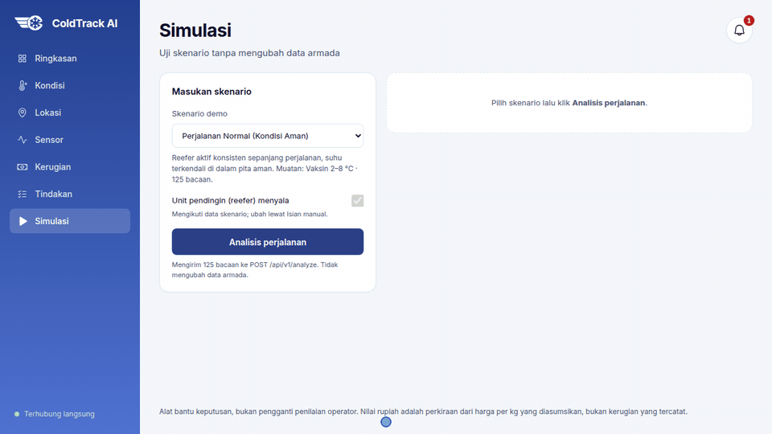

# ColdTrack AI

Sistem prediksi dini kegagalan rantai dingin (cold chain) berbasis AI, dibangun untuk COMPFEST 18 AI Innovation Challenge, kategori Smart Logistics.

ColdTrack memantau armada truk berpendingin secara langsung: telemetri masuk lewat MQTT, worker menjalankan
model per truk, lalu dasbor menampilkan status (AMAN / WASPADA / KRITIS), Time-to-Breach, diagnosis mode
kegagalan, faktor pendorong, tindakan yang disarankan, insiden dengan audit trail, dan estimasi kerugian.



*Halaman Simulasi: pilih skenario telemetri, klik "Analisis Perjalanan", lalu sistem menampilkan status,
Time-to-Breach, diagnosis mode kegagalan, faktor pendorong, dan tiga langkah tindakan.*

## Fitur dasbor

| Halaman | Isi |
|---|---|
| Ringkasan | KPI armada, truk kritis, truk per diagnosis, tabel risiko, peta mini |
| Kondisi | Status semua truk dan prediksinya |
| Detail truk | Kondisi langsung, grafik suhu aktual + prediksi +15/+30/+60 menit, faktor pendorong, tindakan |
| Tindakan | Alur insiden: Tugaskan → Mulai tangani → Tandai selesai, tercatat di audit trail |
| Kerugian | Nilai berisiko, kerugian terjadi, dan yang berhasil diatasi, beserta cara menghitungnya |
| Sensor | Skor kesehatan perangkat per truk dan panel "Perlu diperbarui" |
| Lokasi | Peta Jawa (OpenStreetMap), truk dan depo diwarnai sesuai status |
| Simulasi | Uji skenario lewat `POST /api/v1/analyze`, tidak mengubah data armada |

Notifikasi tampil di lonceng kotak masuk dan sebagai toast saat ada truk yang memburuk (lewat SSE).

## Cara menjalankan

Prasyarat: Docker Desktop (di Windows aktifkan WSL integration), RAM bebas sekitar 4 GB, dan port 3000,
8000, 5432, 1883 tidak sedang dipakai. Salin `.env.example` ke `.env` lalu sesuaikan nilainya.

### Demo armada (dasbor 24 truk virtual, lokal)
```bash
docker compose --profile dev up -d --build
```
Buka http://localhost:3000. `--profile dev` menyalakan simulator `virtual-trucks` yang memutar ulang trip
dari split val v4. Dua menit pertama setiap truk berstatus MENUNGGU DATA karena model butuh 60 menit
data trip (bawaan `SIM_SPEED=30`).

Reset data sebelum presentasi supaya angka notifikasi, insiden, dan kerugian wajar:
```bash
docker compose --profile dev down -v
```

Panduan teknis lengkap: [docs/demo.md](docs/demo.md). Naskah presenter: [docs/demo_5_menit.md](docs/demo_5_menit.md).

### Tanpa simulator (API + dasbor + database saja)
```bash
docker compose up --build
```

### Development (live reload frontend)
Nyalakan stack armada dengan `docker compose --profile dev up -d db mosquitto api worker-ingest worker-infer virtual-trucks`,
lalu jalankan `npm run dev` di `frontend/`. `docker-compose.dev.yml` hanya berisi backend + frontend tanpa database
dan MQTT, jadi di sana hanya halaman Simulasi (`POST /api/v1/analyze`) yang berfungsi.

## Model

- Diagnosis dan forecast: GRU v5 (3 lapis, hidden 128, ditambah 6 fitur konteks trip) dalam ONNX, dengan
  7 kelas mode kegagalan dan forecast suhu t+15/t+30/t+60.
- Status dan Time-to-Breach: mesin fisika/aturan, dengan XGBoost (`coldtrack_ttb.onnx`) untuk TTB.
- Test v5: Macro F1 0,820 dan PR-AUC 0,855 dengan definisi label v5 (A1/A7 sebagai kejadian sementara),
  memenuhi target > 0,80 dan > 0,85. Dengan label lama 0,756 dan 0,812 (v3: 0,668 dan 0,786).
  `degradasi_bertahap` masih lemah. Detail ada di [Model Card](docs/model_card.md).
- Semua data adalah sintetis dari simulator, bukan logger truk nyata.

## Pengujian

```bash
cd backend && ruff check . && pytest      # unit test backend (CI: Backend CI)
cd frontend && npm run lint && npm run build
```
Tes integrasi stack armada (MQTT → DB, dedupe, data terlambat, webhook, prediksi, API, audit, SSE)
berjalan di workflow `Fleet CI` ([.github/workflows/fleet.yml](.github/workflows/fleet.yml)).
Suite evaluasi sistem ada di [eval/](eval/README.md), benchmark latih ulang dan device di [bench/](bench/README.md).

## Struktur repo

```
pakar-coldtrack/
  backend/     FastAPI + worker ingest MQTT / inferensi streaming, TimescaleDB (migrations/), tests/
  frontend/    Next.js 14 (dasbor armada sesuai Figma)
  docker/      Konfigurasi Mosquitto
  ml/          Simulator data, notebook, pelatihan GRU/XGBoost, ekspor ONNX
  eval/        Suite evaluasi sistem sebagaimana di-deploy
  bench/       Latih ulang model dan benchmark antar-device (hasil di bench/results/)
  data/        Data olahan dan dataset Berkeley
  hw/          RTL chip edge KV260 (segel, mesin fisika, tree ensemble), testbench cocotb, skrip Vivado
  docs/        Arsitektur, kontrak, kartu model/dataset, governance, panduan demo, proposal
```

Setiap folder utama punya `README.md` sendiri: [backend](backend/README.md), [frontend](frontend/README.md),
[ml](ml/README.md), [bench](bench/README.md), [eval](eval/README.md), [hw](hw/README.md),
[data](data/README.md), [docker](docker/README.md), [docs](docs/README.md).

## Dokumentasi

- [Architecture](docs/architecture.md)
- [Feature Schema](docs/feature_schema.md)
- [Dataset Card](docs/dataset_card.md)
- [Model Card](docs/model_card.md)
- [AI Governance](docs/ai_governance.md)
- [Demo armada](docs/demo.md) · [Alur demo 5 menit](docs/demo_5_menit.md)
- [Kontrak API](docs/api_contract.md) · [Kontrak perangkat](docs/device_contract.md) · [Asumsi armada](docs/fleet_assumptions.md)
- [Proposal](docs/PROPOSAL.md)
