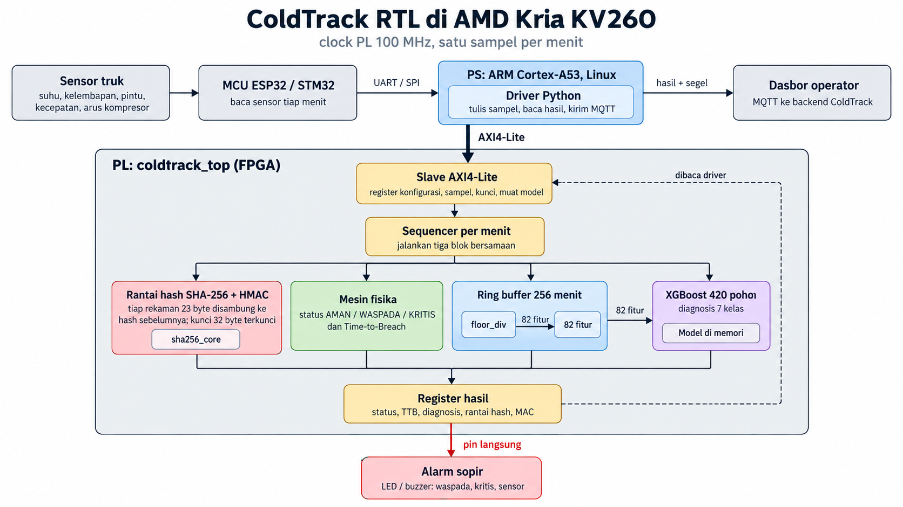
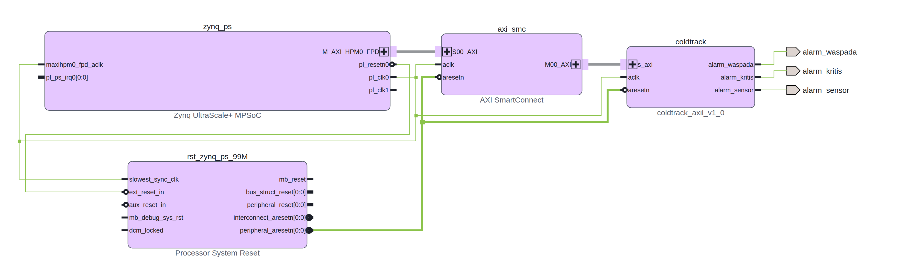

# ColdTrack RTL

Chip ColdTrack untuk truk: segel data sensor (rantai SHA-256 + HMAC), mesin fisika (status
AMAN/WASPADA/KRITIS + TTB), dan diagnosis tree ensemble (XGBoost 420 pohon), di belakang slave AXI4-Lite
untuk ARM pada AMD Kria KV260. RTL ditulis dalam subset SystemVerilog tanpa primitive vendor, jadi bisa
disintesis Vivado maupun Yosys.

| Folder | Isi |
|---|---|
| `rtl/` | Modul sintesis |
| `tb/` | Testbench cocotb (`test_*.py`), dijalankan lewat pytest |
| `golden/` | Model acuan Python bilangan bulat; RTL harus sama bit per bit dengan model ini |
| `scripts/` | Ekspor model XGBoost beku ke berkas memori; vektor uji hasil edge untuk backend; inventaris memori per mode (`asic_mem.py`) |
| `driver/` | Driver: `chip.py` (`ChipAxi` lewat `/dev/mem` untuk KV260, `ChipSpi` lewat `spidev` untuk chip ASIC, keduanya belum diuji di perangkat; `ChipGolden` identik bit per bit dengan RTL) dan `edge_driver.py` (sampel ke chip, kirim bacaan + hasil tersegel lewat MQTT) |
| `model/` | Hasil ekspor: `nodes.mem`, `trees.mem`, `base.mem` per model, plus `flash.bin` dan `flash.sha256` untuk mode flash |
| `bd/` | Pembungkus Verilog AXI4-Lite (`coldtrack_axil.v`) untuk block design Vivado + pin alarm PMOD |
| `synth/` | Skrip Yosys (perkiraan) dan Vivado (implementasi out-of-context, block design KV260, laporan) |
| `docs/` | Gambar arsitektur (`rtl_architecture.png`) dan block design Vivado (`vivado_block_design.png`/`.svg`) |
| `results/` | Laporan paritas golden vs float (JSON) dan laporan Vivado (`results/vivado/`) |

## Arsitektur



```
ARM KV260 (Linux, MQTT/TLS) --AXI4-Lite--> coldtrack_top
   tiap menit: tulis S_* lalu CTRL.sampel_go
     seal        rekaman 23 byte -> rantai SHA-256          (1 kompresi, 65 siklus)
     physics     aturan sensor, observer Tc, TTB T=0..60     (sekitar 75 siklus, perkalian dipipeline)
     features    ring buffer 256 menit -> 82 fitur bulat     (sekitar 650 siklus)
     tree_engine 420 pohon -> skor 7 kelas + argmax          (sekitar 3.800 siklus)
   STATUS.hasil_valid -> baca R_*; CTRL.mac_go -> HMAC {rantai, paket hasil 16 byte}
   pin alarm_waspada / alarm_kritis / alarm_sensor untuk sopir
```

Peta register dan format paket hasil: `golden/regmap.py`. Format rekaman segel: `golden/seal.py`.
Satuan semua masukan: suhu, kelembapan, kecepatan 0,01; radiasi 1/16 W/m2; siklus kerja 1/10000. Satuan
desimal membuat kelipatan 0,1 C data latih eksak, karena ambang pohon XGBoost sering tepat di nilai data.

## Status verifikasi

| Tahap | Modul | Hasil |
|---|---|---|
| M1 | `golden/physics.py` vs `engine.py` | 214.406 menit (594 trip train/val + 5 skenario). 5 skenario 100 % identik; dari 195 menit berbeda, 193 adalah seri tepat di ambang (float memutus acak), 2 karena sebab lain; tidak ada menit KRITIS float tapi AMAN golden |
| M1 | `golden/trees.py` vs XGBoost float | val 16.414 jendela: kelas sama 99,80 % (#7), 99,90 % (#8); Macro F1 0,848 vs 0,852 dan 0,930 vs 0,933 |
| M2 | `sha256_core`, `seal` | NIST FIPS 180-4 + 31 pesan acak; rantai + HMAC identik `hashlib`/`hmac`; kunci terkunci; manipulasi terdeteksi |
| M3 | `tree_engine` | 240 jendela val, skor 7 kelas + argmax identik golden; model dari berkas dan dimuat host |
| M4 | `floor_div`, `features` | 609 kasus pembagian; 825 jendela lengkap (1.997 menit, 6 trip) 82 fitur identik |
| M5 | `physics` | 7.136 menit (2 trip per mode A0-A8 + 5 skenario) identik semua keluaran |
| M6 | `coldtrack_top` (AXI4-Lite) | 709 menit dua trip penuh: fisika, rantai, 296 diagnosis, 26 HMAC identik golden |
| M7 | Sintesis Yosys KV260 | perkiraan resource, lihat tabel di bawah |
| M8 | Vivado KV260 (block design, place-and-route) | lolos 100 MHz, WNS +1,351 ns, WHS +0,011 ns; bitstream + `.xsa` dibuat. Belum diuji di board |
| M9 | `sha256_stream` | 25 pesan (0 sampai 2.000 byte, termasuk semua batas padding) identik `hashlib` |
| M9 | `model_flash` (mode flash) | 20 jendela val identik golden; byte image dibalik, model lain, dan header buruk ditolak |
| M9 | `coldtrack_top` mode flash | 150 menit dua trip identik golden; satu menit dengan image dirusak: diagnosis dibuang, fisika, rantai, dan HMAC tetap identik |
| M10 | `coldtrack_spi` (top ASIC: SPI + flash) | uji M9 diulang lewat SPI pada SCK = clk/8 (batas terburuk): 150 menit identik; frame yang terputus diabaikan |
| M10 | Sapuan SPI (`tb/test_spi_sweep.py`) | 13 kecepatan x 4 offset fase, 8 ronde baca-tulis tiap konfigurasi: nol kesalahan sampai clk/3, gagal semua di clk/2,5 dan clk/2 (`results/spi_sweep.json`) |

Catatan dari verifikasi: aturan "pintu terbuka, sisa waktu terburuk <= 30 menit" (alasan 4) di `engine.py`
tidak pernah bisa menentukan status. Saat pintu terbuka kabin = max(ts10, suhu luar) >= suhu luar dan
(x - t_hi)/(x - Tc) naik terhadap x, sehingga TTB biasa selalu <= TTB kasus terburuk dan aturan TTB lebih
dulu memicu dengan status yang sama atau lebih tinggi. RTL tetap memuat aturan itu agar setara backend.

## Mode flash untuk ASIC

Di ASIC tidak ada BRAM, dan tabel simpul pohon (8.704 x 72 bit = 76,5 KiB) adalah bagian terbesar chip. Karena
isinya konstanta, `MODEL_FLASH = 1` memindahkannya ke flash QSPI eksternal. Bawaannya tetap `MODEL_FLASH = 0`
(BRAM), jadi build KV260 dan semua angka Vivado di bawah tidak berubah.

```
coldtrack_top (MODEL_FLASH = 1)
  model_flash   start -> qspi_reader baca image dari alamat 0 (perintah 0x6B, 6 pin)
                  tiap byte -> sha256_stream (hash seluruh image)
                            -> rakit rekaman 9 byte -> tree_stream (evaluasi pohon dari aliran)
                  hash == HASH_MODEL, dicek dua kali sebagai pola 8 bit -> pola_sah 0xA5
  model tidak sah -> diag_valid 0, kelas dan skor dibuang, STATUS.bit7 0, R_MODEL menghitung kegagalan;
                     status fisika, TTB, alarm, dan segel tetap jalan
```

- **Image flash** (`golden/flash_image.py`): header, base score, lalu per pohon satu rekaman kepala dan
  simpulnya. Format simpul sama dengan `nodes.mem`. Syarat aliran (simpul satu pohon berurutan, anak selalu
  sesudah induk) dicek saat ekspor. Model sekarang: 78.714 byte (#8) dan 80.172 byte (#7).
- **Waktu:** satu inferensi membaca seluruh image, 316.313 siklus (3,2 ms pada 100 MHz dengan SCK 50 MHz).
  Waktunya tetap, tidak bergantung pada kedalaman pohon. Jeda antar sampel 60 detik.
- **HASH_MODEL** ditanam saat sintesis dari `model/<nama>/flash.sha256`. Ganti model berarti ganti hash, jadi
  untuk prototipe model ikut terkunci di chip. Agar model bisa diperbarui di lapangan dibutuhkan tanda tangan
  digital (kunci publik di chip), yang belum dibuat.
- **Flash:** bit QE harus diset saat flash diprogram. `qspi_io_o`/`qspi_io_oe`/`qspi_io_i` disambungkan ke
  penyangga tiga keadaan di pad.

### Antarmuka SPI (top ASIC `coldtrack_spi`)

Di ASIC tidak ada ARM di die yang sama, jadi AXI4-Lite (sekitar 108 sinyal) tidak bisa ditarik keluar sebagai pin.
`coldtrack_spi` menaruh `spi_axil_bridge` di depan `coldtrack_top`. Register map tetap sama, dan mikrokontroler
mengaksesnya lewat 4 pin SPI. Total pin chip: clk, rst_n, SPI 4, QSPI 6, alarm 3.

| Frame (SPI mode 0, MSB dulu, satu per CS rendah) | MOSI | MISO |
|---|---|---|
| Tulis, 6 byte | `{1, 000, alamat[11:0]}` + data 32 bit | diabaikan |
| Baca, 7 byte | `{0, 000, alamat[11:0]}` + 1 byte dummy + 4 byte bebas | data 32 bit di 4 byte terakhir |

- SCK, CS, dan MOSI dicuplik clk chip lewat sinkroniser 2 FF, jadi **SCK paling cepat clk/8** (12,5 MHz pada
  100 MHz, 6,25 MHz pada 50 MHz). Data ColdTrack sekitar 150 byte per menit, jadi batas ini tidak terasa.
- Sapuan simulasi (`tb/test_spi_sweep.py`, termasuk rasio pecahan dan 4 offset fase) bebas kesalahan sampai
  clk/3 dan gagal mulai clk/2,5: MISO berganti 2 sampai 3 clk setelah tepi naik SCK, jadi satu periode SCK harus
  lebih dari sekitar 3 clk. Simulasi tidak memodelkan delay pad, jalur PCB, jitter, dan metastabilitas, jadi
  batas resmi tetap clk/8 (cadangan sekitar 2,7x). Batas silikon diukur ulang di chip.
- Frame yang terputus (CS naik sebelum bit terakhir) diabaikan. Byte dummy memberi waktu chip membaca register
  sebelum bit data pertama dikirim.
- Encoder frame: `golden/spi_frame.py`. Driver: `ChipSpi` di `driver/chip.py`, atau `edge_driver.py --chip spi`.
- Kunci HMAC ikut dikirim lewat SPI saat boot, karena PDK open source tidak punya OTP/eFuse.

Inventaris memori (`python -m hw.scripts.asic_mem`, Yosys `memory -nomap`, tanpa sintesis penuh):

| Memori | Mode BRAM | Mode flash |
|---|---|---|
| `mem_simpul` 8.704 x 72 | 76,5 KiB | dihapus |
| `mem_pohon` 420 x 19 + `mem_base` 8 x 32 | 1,0 KiB | dihapus |
| Ring buffer `features` 256 x 111 | 3,5 KiB | 3,5 KiB |
| Tabel fitur 82 x 48 | 0,5 KiB | 0,5 KiB |
| **RAM tulis** | **81,5 KiB** | **3,9 KiB** |
| ROM konstanta (tabel K SHA-256, konstanta fisika) | 0,3 KiB | 0,5 KiB |

Mode flash memakai inti SHA-256 kedua untuk hash image, jadi tabel K ada dua. Inti ini bisa dibagi dengan
`seal` bila luas logika perlu dihemat. Luas ASIC sebenarnya baru diketahui setelah sintesis dengan PDK.

## Vivado KV260 (post-route, model #8)



Block design: Zynq UltraScale+ PS (preset board `kv260_som`) -> SmartConnect -> `coldtrack_axil` di
`0xA000_0000` (4 KB), clock `pl_clk0` 100 MHz, alarm ke PMOD J2 (`bd/kv260_alarm.xdc`, cocokkan pin dengan
UG1089 sebelum dipakai).

| Resource | Terpakai | Porsi K26 |
|---|---|---|
| LUT | 12.240 (133 sebagai memori) | 10,5 % |
| FF | 18.682 | 8,0 % |
| BRAM36 | 20 | 13,9 % |
| DSP | 74 | 5,9 % |

Tabel simpul `tree_engine` (8.704 x 72) memakai 18 BRAM dan ring buffer `features` (256 x 111) 2 BRAM.
Sebelumnya keduanya jatuh ke LUTRAM (27.248 LUT, 12.069 sebagai memori) karena register baca BRAM diserap
primitif lain: `simpul_q` menjadi register alamat LUTRAM `fitur`, `rd_q` menjadi register masukan DSP. Kini
ada satu register tambahan di depan keduanya dan `rd_q` diberi `keep`.

Timing `coldtrack_top` out-of-context per frekuensi (`synth/kv260_vivado.tcl`, laporan di
`results/vivado/sweep/`). Daya adalah logika PL saja; daya total block design (termasuk PS) 2,86 W.

| Clock | WNS | Daya PL total / dinamis |
|---|---|---|
| 10 MHz | +88,06 ns | 0,303 W / 0,014 W |
| 25 MHz | +29,05 ns | 0,318 W / 0,029 W |
| 50 MHz | +9,12 ns | 0,348 W / 0,059 W |
| 100 MHz | +0,637 ns (block design +1,351 ns) | 0,407 W / 0,118 W |

Sebelum perbaikan, 100 MHz gagal tipis (WNS -0,146 ns) di pencarian TTB `physics` (selisih -> perkalian 82 bit
-> bandingkan, 23 level). Perkalian TTB dan aturan pintu kini melewati 3 register pipeline, jumlah `features`
dihitung satu siklus sebelum digeser, dan `flat` diregister sebelum aturan sensor.

## Resource KV260 (Yosys `synth_xilinx -family xcup`, model #8, sebelum pipeline)

| Modul | LUT | FF | BRAM36 | DSP |
|---|---|---|---|---|
| `physics` | 4.436 | 3.076 | 0 | 37 |
| `features` | 3.980 | 2.315 | 2 | 38 |
| `floor_div` | 405 | 296 | 0 | 0 |
| `tree_engine` | 1.124 (+288 LUTRAM) | 481 | 18 | 0 |
| `sha256_core` | sekitar 1.880 | 1.289 | 0 | 0 |
| `seal` (tanpa SHA) | 724 | 1.738 | 0 | 0 |
| `coldtrack_top` (AXI + sequencer) | 1.503 | 1.207 | 0 | 0 |
| **Total** | **14.054 (+288 LUTRAM)** | **10.402** | **20** | **75** |
| Kapasitas K26 | 117.120 | 234.240 | 144 | 1.248 |
| Porsi | 12 % | 4,4 % | 14 % | 6 % |

Angka Yosys adalah perkiraan sebelum place-and-route.
